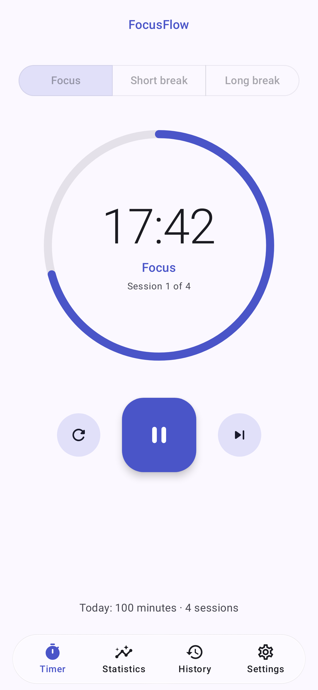
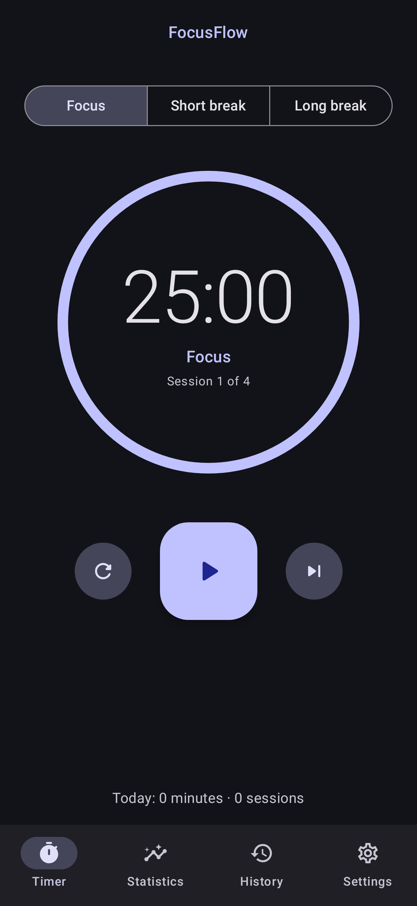
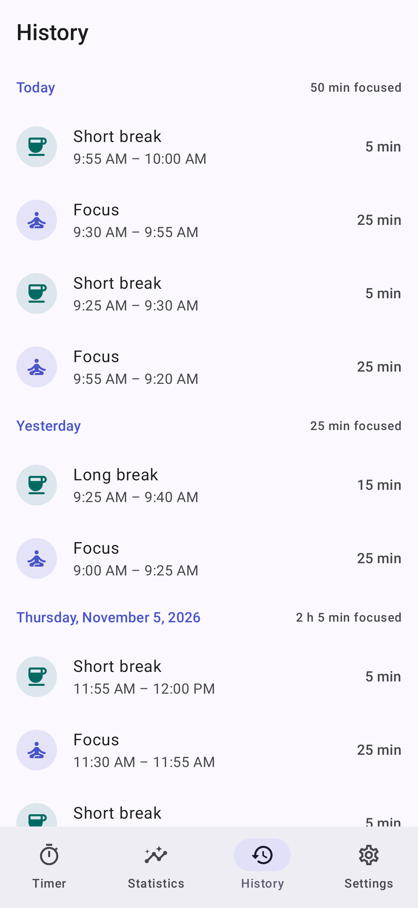
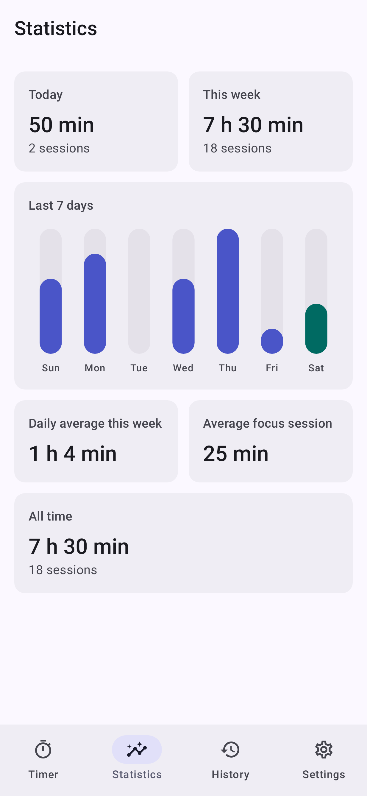
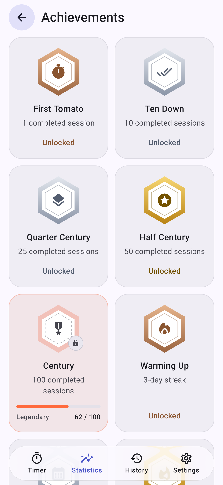

# FocusFlow

**Focus better. Work smarter.**

FocusFlow is a minimalist, offline-first Pomodoro timer for Android and iOS, built with Kotlin,
Jetpack Compose and Compose Multiplatform by **Bima Adam Nugraha**, AI-native engineer at
[IgnitronDev](https://ignitrondev.space).

* **Private by design:** no account, no analytics, no ads, and no internet permission. Your
  sessions never leave the device, unless you choose to share a statistics card.
* **Reliable:** the timer keeps the right time when the app is closed, the screen is off, the clock
  changes or the phone restarts, and alerts you when a session ends.
* **Open source:** Apache License 2.0, with no Google Play Services or proprietary libraries, so it
  can be published on F-Droid.

> **Status: 1.0.2, stable.** Please
> [report problems](https://github.com/ignitrondev/FocusFlow/issues/new/choose), especially about
> alerts on your device.

<p>
  
  
  
  
  
</p>

## Features

| | |
|---|---|
| Pomodoro cycle | 25 minutes of focus, 5 minute breaks, a 15 minute break after every 4 sessions; all adjustable |
| Controls | Start, pause, resume, reset, skip; optional automatic start of breaks and focus sessions |
| Alerts | Sound and vibration when a session ends, also with the app closed; pick any alarm or notification sound; notification with the time left in large digits, Pause and Resume |
| History | Every session by day, including the ones you stopped early |
| Statistics | Today, this week, daily average, average session, streak, and a chart of the locale week |
| Achievements | 13 badges for sessions, streaks and hours of focus, in bronze, silver, gold and legendary |
| Share | A Strava-style card of your day or week, as a feed post (1080×1350) or a full-screen story (1080×1920), with your role and, if you like, a photo of where you are working |
| Everywhere | A Liquid Glass navigation bar, light and dark theme, wallpaper colors (Material You), English and Bahasa Indonesia, phones, foldables and tablets, large font sizes, TalkBack |

## Download

Get the APK from the [Releases](https://github.com/ignitrondev/FocusFlow/releases) page
(Android 8.0 or newer). FocusFlow is not on F-Droid yet: F-Droid takes apps after at least three
months of development, so it will be submitted in February 2027.

**iPhone and iPad (iOS 15 or newer, beta):** there is no App Store version. Install the unsigned
build with [AltStore](https://altstore.io) or [SideStore](https://sidestore.io) and your own Apple
ID. In the app, open **Sources → +** and paste:

```
https://raw.githubusercontent.com/ignitrondev/FocusFlow/main/altstore/source.json
```

On an iPhone that already has AltStore, [this link](altstore://source?url=https://raw.githubusercontent.com/ignitrondev/FocusFlow/main/altstore/source.json)
opens the add-source screen. SideStore uses the
[same link](sidestore://source?url=https://raw.githubusercontent.com/ignitrondev/FocusFlow/main/altstore/source.json).
FocusFlow then shows up in **Browse**. A free Apple ID has to refresh the app every 7 days.
Step by step, in Bahasa Indonesia: [docs/IOS_INSTALL.md](docs/IOS_INSTALL.md).

To check that an APK was signed by IgnitronDev, compare its certificate
(`apksigner verify --print-certs FocusFlow-*.apk`) with this SHA-256 fingerprint:

```
5a:ad:b1:31:3d:4a:ad:9a:c1:d0:2a:df:ef:5d:03:e6:79:de:57:aa:62:66:93:70:db:06:b0:83:aa:94:b1:ee
```

### Permissions

| Permission | Why |
|---|---|
| Notifications | To alert you when a session ends. Asked the first time you start a session; the timer works without it. |
| Exact alarms | So the alert, and an automatic break, start exactly when the session ends. Granted automatically on Android 13+ (timer apps may use it); on Android 12 it can be turned off in Settings → Notifications. |
| Run at startup | To restore a running timer after the phone restarts. |

FocusFlow does **not** request internet access.

## Build from source

Requirements: JDK 21 and the Android SDK (compile SDK 37).

```bash
git clone https://github.com/ignitrondev/FocusFlow.git
cd FocusFlow
./gradlew assembleDebug
```

| Document | |
|---|---|
| [DEVELOPMENT.md](docs/DEVELOPMENT.md) | Commands, conventions, release builds |
| [ARCHITECTURE.md](docs/ARCHITECTURE.md) | Layers and data flow |
| [TIMER_ENGINE.md](docs/TIMER_ENGINE.md) | How the timer stays correct, alarms and platform limits |
| [DATABASE.md](docs/DATABASE.md) | Schema and migration rules |
| [QA.md](docs/QA.md) | What is tested, and the manual device checklist |
| [ROADMAP.md](docs/ROADMAP.md) | What is next |
| [CHANGELOG.md](CHANGELOG.md) | Release notes |

Tech stack: Kotlin, Jetpack Compose, Material 3, Navigation Compose, Hilt, Coroutines/Flow, Room,
DataStore, AlarmManager; JUnit and Robolectric for tests.

## Contributing

Contributions are welcome. No CLA is required; read [CONTRIBUTING.md](CONTRIBUTING.md), the
[Code of Conduct](CODE_OF_CONDUCT.md) and the [security policy](SECURITY.md) first.

## License

Created by Bima Adam Nugraha. Copyright 2026 IgnitronDev. Licensed under the
[Apache License 2.0](LICENSE).

FocusFlow started in a fork of [android/compose-samples](https://github.com/android/compose-samples)
(Copyright The Android Open Source Project, Apache-2.0) and reuses its build setup; see
[NOTICE](NOTICE) for attribution.
