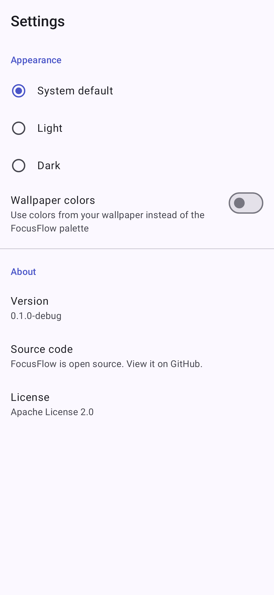

# FocusFlow

**Focus better. Work smarter.**

FocusFlow is a minimalist, offline-first Pomodoro timer for Android, built with Kotlin and
Jetpack Compose by [IgnitronDev](https://ignitrondev.space).

* **Private by design:** no account, no analytics, no ads, and no network permission. Your
  sessions never leave the device.
* **Open source:** Apache License 2.0, built so it can be published on F-Droid (no Google Play
  Services, no proprietary libraries).
* **Made for every screen:** Material 3, light/dark theme, optional dynamic color, adaptive
  navigation for phones, foldables and tablets.

> **Status: early development.** The Pomodoro timer works: start, pause, resume, reset and
> skip, with the long-break cycle, and it keeps correct time across app restarts and reboots.
> Notifications when the app is closed, history and statistics are next. See the
> [roadmap](docs/REPOSITORY_AUDIT.md#8-phase-plan) and [how the timer works](docs/TIMER_ENGINE.md).

<p>
  
  
  
</p>

<sub>Screenshots of the in-development UI, rendered with sample data.</sub>

## Planned features

| | |
|---|---|
| Timer | Focus, short break and long break; start, pause, resume, reset, skip; automatic cycle |
| Reliable | Keeps the right time when the app is closed, the screen is off or the phone restarts |
| Notifications | Ongoing countdown and a completion alert, with no always-on background service |
| History | Completed and interrupted sessions, grouped by day |
| Statistics | Focus time today and this week, completed sessions, daily average |
| Settings | Durations, sessions per cycle, theme, sound and vibration |

## Download

There is no public release yet. Signed APKs will be published on the
[Releases](https://github.com/ignitrondev/FocusFlow/releases) page, and an F-Droid submission is
planned. Development builds (debug APK) are attached to every
[CI run](https://github.com/ignitrondev/FocusFlow/actions/workflows/ci.yml).

## Build from source

Requirements: JDK 21 and the Android SDK (compile SDK 37).

```bash
git clone https://github.com/ignitrondev/FocusFlow.git
cd FocusFlow
./gradlew assembleDebug
```

Tests, release builds, conventions and tooling are described in
[docs/DEVELOPMENT.md](docs/DEVELOPMENT.md).

Tech stack: Kotlin, Jetpack Compose, Material 3, Navigation Compose, Hilt, Coroutines/Flow,
DataStore, Room, JUnit and Robolectric.

## Contributing

Contributions are welcome. No CLA is required; read [CONTRIBUTING.md](CONTRIBUTING.md), the
[Code of Conduct](CODE_OF_CONDUCT.md) and the [security policy](SECURITY.md) first.

## License

Copyright 2026 IgnitronDev. Licensed under the [Apache License 2.0](LICENSE).

FocusFlow started in a fork of [android/compose-samples](https://github.com/android/compose-samples)
(Copyright The Android Open Source Project, Apache-2.0) and reuses its build setup; see
[NOTICE](NOTICE) for attribution.
